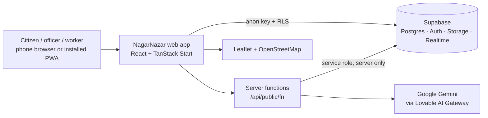

# NagarNazar · नगर नज़र

**Your city, under watch. Every complaint tracked, every fix proven.**
**आपका शहर, आपकी नज़र। हर शिकायत ट्रैक, हर काम का सबूत।**

Team SANT — Mohit Katara (Team Lead) · Built for **RunUp Coders Hackathon 2026** (Round 2) · Formerly "Civic Tracker" · Pilot city: Ratlam, Madhya Pradesh

- **Live app:** https://nagarnazar.lovable.app
- **GitHub:** https://github.com/mohitk518/nagarnazar
- **What changed in this hackathon:** [New in RunUp Coders Hackathon 2026](#new-in-runup-coders-hackathon-2026)

---

## The problem

In small Indian cities, a pothole, an overflowing garbage point or a dead streetlight is usually reported by a phone call, a WhatsApp forward or a paper application. The citizen gets no reference number, no idea which department owns the problem, and no proof that anything was fixed. Officials, on the other hand, cannot see which wards keep complaining, which complaints are overdue, or where to send field workers first.

## The solution: Click → Route → Prove

1. **Click** — the citizen takes a photo. GPS location, ward and city are detected; the problem can also be spoken in Hindi or English.
2. **Route** — the complaint goes automatically to the right department with a deadline (SLA). Overdue complaints escalate.
3. **Prove** — a complaint is closed only with an after-repair photo. Anyone can open the public complaint page (or scan its QR poster) and see the before/after proof and the full timeline.

Target users: citizens, municipal officers / city admins and field workers in small Indian cities.

## Key features

**Citizens**
- Photo + GPS + voice complaint, step-by-step report flow, Hindi and English interface
- Duplicate warning (same category within ~300 m in the last 7 days)
- Public complaint page with a unique ID (e.g. `CT-142`), live status, deadline countdown, timeline, QR poster and before/after photos
- Upvote, "I have seen this too" verification, comments, rating, points and badges, polls
- Works offline for drafts and can be installed as an app
- Privacy page and self-service account deletion

**Officials and field workers**
- City-scoped admin panel (row-level security), ward-wise complaint view, worker assignment, field-worker job page
- After-repair photo required to resolve, merge duplicates, automatic escalation
- AI weekly/monthly reports, trend predictions, CSV/PDF export

**Planners / public**
- Live map with clusters and heatmap, public dashboard, accountability scores

## New in RunUp Coders Hackathon 2026

Everything below was built between 15 and 24 November 2026; the commit dates on GitHub are the record. Everything else in this README was **pre-existing** in the earlier Civic Tracker project (see [Project history & credits](#project-history--credits)).

- **Rebrand to NagarNazar** — new name, Hindi name, tagline, PWA manifest, meta tags, poster/share text and footer in both languages; old competition material removed.
- **New UI/UX** — new design system (indigo `#1E1B4B`, saffron `#F59E0B`, green/red status colours, Poppins/Inter + Mukta for Hindi), original eye-and-pin logo and app icons, pill buttons with 44px+ touch targets, rounded cards and colour-coded status chips (Pending / In progress / Resolved / Overdue), a fixed mobile bottom bar (Home · Map · **+ Report** · My complaints · Profile), a new home page whose live stats (total, resolved, average time to fix) come from real data, a new step-by-step report flow (Photo → Location/ward → Details → Review) with a progress bar on its own `/report` page, a "My complaints" view, a skip link, visible keyboard focus and an optional dark mode. Checked with axe-core (WCAG 2.1 AA rules): 0 violations on 10 pages at mobile and desktop widths.
- **Ward / zone (feature 1)** — ward picker in the report form (the city's ward list, or a ward-number box when a city has no wards), the ward shown on the complaint page, the public list and the admin list, a ward filter in the admin panel, and a new **ward-wise complaints** chart + table (total / pending / in progress / resolved / overdue) for admins. Migration `supabase/migrations/20261116120000_reported_ward.sql` adds a nullable `reported_ward` text column; old complaints without a ward keep working, and reporting still works before the migration is applied. *Pre-existing:* automatic ward detection from GPS (`ward_id` via the `route_new_complaint` trigger), ward set-up for admins and the ward filter on the public complaints page.
- **Offline-ready, installable app (feature 2)** — a service worker (`public/sw.js`, hand-written because the Lovable/nitro Cloudflare build does not run vite-plugin-pwa) caches the app shell (`/`, `/report`, icons, manifest) and the hashed build files, so the app opens and the report form works without a network; live data, AI and photos are never cached. An app-wide "You're offline / आप ऑफ़लाइन हैं" banner. The complaint draft (text, category, location, ward **and the photo as a Blob**) is now kept in IndexedDB instead of localStorage (the old version dropped photos over ~2 MB); old drafts are migrated. When the network returns with a complaint waiting, the app asks **"Send draft? / ड्राफ़्ट भेजें?"** — on the report page and as a prompt on any other page — instead of sending silently. Manifest renamed to NagarNazar with any + maskable icons. Tested end to end in Chrome on a local production build: service worker activated, offline reload opened the cached report page with the banner, and a 2.96 MB photo draft was restored intact. *Pre-existing:* the Install page, a form-level offline notice and a localStorage text draft.
- **Privacy controls (feature 3)** — "Delete my account" on the Profile page and on `/privacy`, with **two confirmations** (a dialog that lists exactly what happens, then typing DELETE / हटाएं). Deletion runs in a server function with the service-role key kept on the server: complaints are first anonymised ("Deleted user", WhatsApp number removed, unlinked from the account) — if that fails nothing is deleted — then the profile (incl. phone), comments, votes, ratings, notifications, roles and other personal rows are removed, then the login. The deletion steps live in `src/lib/account-deletion.ts` with unit tests. A rewritten bilingual `/privacy` page answers: what data, why, how long, who sees it, how to delete, contact. Privacy links in the footer, the menu and the sign-up form. *Pre-existing:* a first version of the privacy page and a one-step "type DELETE" account deletion that cleared fewer tables and ignored errors.
- **Reliable AI (feature 4)** — every Gemini call now goes through one server wrapper (`src/lib/ai-gateway.server.ts`, 13 s timeout → HTTP 504) and one browser wrapper (`src/lib/invoke-function.ts`: ~15 s per attempt, 2 retries with exponential backoff 1 s → 2 s, never throws). The streamed chat assistant uses the same rules (`fetchAiStream`). Voice speech-to-text gets a longer budget because voice notes have no length limit. If the AI summary fails, the complaint is still saved with the citizen's own category, the citizen sees **"AI analysis will happen later / AI विश्लेषण बाद में होगा"**, and the app retries in the background (on start, when back online and every 5 minutes, up to 24 h; the server now allows the reporter to request a missing summary for 24 h instead of 15 min). *Pre-existing:* a browser wrapper with a 20 s timeout and 2 retries, and non-blocking AI category suggestions.

## Testing (Round 2)

| Check | Result | How |
|---|---|---|
| Unit tests (Vitest) | **79 passing** (44 before the hackathon) | `bun run test` — new tests cover ward insert fallback and ward summary, IndexedDB drafts and the manifest, account-deletion order, AI timeout/retry/"later" queue, live stats and the overdue chip |
| Type check / build | pass | `tsc --noEmit`, `bun run build` |
| Accessibility (axe-core 4, WCAG 2.1 A/AA rules) | **0 violations** on 10 pages, mobile 390 px and desktop 1366 px, light and dark | headless Chrome on a local build |
| Lighthouse 12 (mobile) | **Accessibility 100, SEO 100** on `/`, `/report`, `/privacy`, `/complaints`; Performance 62–76 and Best practices 76 | local production build over plain HTTP with a dummy backend, so Performance/Best-practices are not representative of the live site |
| Offline / PWA, end to end | pass | Chrome on a local production build: service worker activated; offline reload opened the cached `/report` with the offline banner; a 2.96 MB photo draft came back from IndexedDB; "Send draft?" appeared on reconnect (report page and home page) |

Not done in this round: the end-to-end scripts in `scripts/` (they need server keys and the shared live database, so they were not run), and there are no Playwright tests in this repository.

### One-time setup for this deployment

Apply `supabase/migrations/20261116120000_reported_ward.sql` (adds the nullable `complaints.reported_ward` column). Until it is applied the app works normally; only the ward the citizen typed/chose is not stored.

## Tech stack

| Layer | Technology |
|---|---|
| Frontend | React 19, TypeScript, TanStack Start + TanStack Router, Vite |
| UI | Tailwind CSS 4, shadcn/ui (Radix UI), lucide-react, framer-motion, sonner |
| Data | TanStack Query, Supabase JS client |
| Maps | Leaflet, react-leaflet, Leaflet.markercluster, Leaflet.heat, OpenStreetMap |
| Charts | Recharts |
| Backend | Supabase (Postgres + row-level security, Auth, Storage, Realtime) on Lovable Cloud |
| Server logic | TanStack Start server routes in `src/routes/api/public/fn` and server functions in `src/lib/*.functions.ts` |
| AI | Google Gemini (2.5 Flash, 2.5 Flash-Lite, 3 Flash preview) through the Lovable AI Gateway, server-side only |

### Where AI (Gemini) is used

| Server function | What it does |
|---|---|
| `analyze-image` | Suggests a category from the complaint photo (the citizen must confirm it) |
| `generate-summary` | Short summary and priority check after submission |
| `analyze-sentiment` | Tone/urgency score |
| `voice-stt`, `voice-transcribe` | Speech to text (Hindi/Hinglish) and structuring a spoken complaint |
| `civic-chat` | Chat assistant that answers from live complaint data |
| `predict-trends`, `generate-admin-report` | Two-week forecasts and AI insights in admin reports |
| `whatsapp-webhook` | Test-mode WhatsApp intake |

## Architecture



## Run locally

Prerequisites: Node.js 20+ and Bun (or npm), a Supabase project, and a Lovable AI Gateway key for the Gemini features.

```bash
git clone https://github.com/mohitk518/nagarnazar.git
cd nagarnazar
bun install            # or: npm install
cp .env.example .env   # fill in your own values — never commit .env
bun run dev            # or: npm run dev
```

Other scripts:

```bash
bun run build    # production build
bun run test     # unit tests (Vitest)
bun run lint     # ESLint
```

Database: apply the SQL in `drizzle/migrations` to a fresh Supabase project. The Platform Super Admin is identified by `app_config.root_admin_user_id`, never by email.

### Configuration

| Variable | Where | Purpose |
|---|---|---|
| `VITE_SUPABASE_URL`, `VITE_SUPABASE_PUBLISHABLE_KEY`, `VITE_SUPABASE_PROJECT_ID` | Browser | Public project URL and publishable (anon) key |
| `SUPABASE_URL`, `SUPABASE_PUBLISHABLE_KEY` | Server | Backend access for server functions |
| `SUPABASE_SERVICE_ROLE_KEY` | Server only | Used only on the server (e.g. account deletion). Never shipped to the browser |
| `LOVABLE_API_KEY` | Server only | Gemini through the Lovable AI Gateway |
| `TWILIO_API_KEY`, `TWILIO_FROM_NUMBER` | Server only | Optional real SMS |

No real keys are stored in this repository.

## Security and privacy

- Row-level security on every table; city admins only manage their own city.
- Phone/WhatsApp numbers are column-restricted and never public; anonymous reporting hides the reporter's name.
- Integrity triggers stop clients from faking status changes, points, escalations or audit logs; rate limits on reporting.
- Photos are stored in a private bucket and validated by real image bytes before they are served.
- See [SECURITY.md](SECURITY.md) and the pre-hackathon audit reports in [docs/](docs/).

## Project history & credits

NagarNazar is built on an earlier civic-complaint platform developed by Mohit Katara with Divyansh Mathur. The features listed under 'New in RunUp Coders Hackathon 2026' were developed during this hackathon.

The earlier project (named "Civic Tracker") already had: photo/GPS/voice complaints, duplicate warning, department routing with deadlines and escalation, worker assignment, public complaint pages with QR and before/after proof, map and heatmap, Gemini features, points/badges/polls, multi-city admin, Hindi/English, and the security work documented in `docs/`. Earlier versions of ward routing, offline drafts, the privacy page and AI retries also existed; what was added or rebuilt on top of them during the hackathon is listed in the "New in" section.

## AI assistance and libraries disclosure

- **In the product:** Google Gemini via the Lovable AI Gateway. AI results are suggestions that a citizen or official confirms.
- **Building the product:** code was written with AI assistance (Lovable and Claude), directed and reviewed by Team SANT.
- **Libraries/APIs:** listed in the tech stack above and in [THIRD_PARTY_NOTICES.md](THIRD_PARTY_NOTICES.md). Map data © OpenStreetMap contributors (ODbL).

## License

MIT — see [LICENSE](LICENSE).
